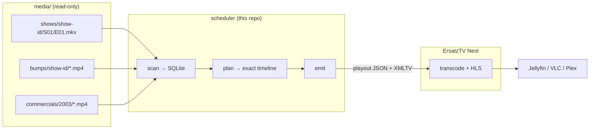

# Nostalgia Machine

[](https://github.com/dooz-bag/nostalgia-machine/actions/workflows/tests.yml)
[](LICENSE)


A deterministic 24/7 IPTV channel that recreates an early-2000s **[adult swim]**
programming block — correct shows, correct order, and bumps that actually name the
show they sit next to.

> **Bring your own media.** This project never downloads anything. It scans
> folders you already own and builds a schedule from them. It is for personal
> copies; do not rebroadcast it.

> **Scope.** This is a personal project built to run one channel well, not a
> general-purpose TV platform. It is deliberately not a Plex plugin, not
> multi-channel, and it will not fetch media for you. Issues that ask it to become
> something else are likely to be closed — but bug reports, accuracy fixes and
> "this didn't work on my machine" are genuinely welcome.



## Why this exists

Every self-hosted "make my own TV channel" tool treats filler as anonymous.
Tunarr, ErsatzTV legacy, DizqueTV and friends pick a random commercial when a gap
opens. But a 2003 [adult swim] break is not anonymous: the card that says *"next
up: Futurama"* belongs immediately before *Futurama*, and *"we now return to Aqua
Teen"* belongs immediately after *Aqua Teen*.

Only the thing that decides the schedule knows that adjacency. So this project is
the scheduler, and it delegates streaming to **ErsatzTV Next**, which is precisely
designed to consume a playout document produced by someone else.

Read [docs/ARCHITECTURE.md](docs/ARCHITECTURE.md) for the design, and
[docs/OPTIONS.md](docs/OPTIONS.md) for why the alternatives (Tunarr, legacy
ErsatzTV, a hand-rolled ffmpeg pipeline) were not chosen.

## Quickstart

Requires Python 3.12+ and ffmpeg on `PATH`.

```powershell
# 1. install
.\run.ps1 setup

# 2. put your media in place
#    media\shows\aqua-teen-hunger-force\Season 01\...S01E01.mkv
#    media\bumps\aqua-teen-hunger-force\card-01.mp4
#    media\commercials\2003\ad-0001.mp4
#    (a raw download can be filed for you: .\run.ps1 import D:\downloads\Futurama)

# 3. catalogue it
.\run.ps1 scan

# 4. look at the schedule before committing to it
.\run.ps1 plan --date 2003-06-16

# 5. build playout JSON + XMLTV
.\run.ps1 emit

# 6. watch it
.\run.ps1 stream        # http://localhost:8409/channels.m3u
```

With Docker instead:

```bash
cp .env.example .env      # set MEDIA_DIR and TZ
docker compose up -d --build
# channel list: http://localhost:8409/channels.m3u
# guide:        http://localhost:8409/xmltv.xml
```

### Watching it

| Client | How |
|---|---|
| **VLC / any IPTV player** | Add `http://<host>:8409/channels.m3u` |
| **Jellyfin / Emby** | Live TV → add tuner, type **M3U**, that URL. Then add guide data → **XMLTV** → `http://<host>:8409/xmltv.xml` |
| **Plex** | Needs an HDHomeRun-style tuner, which ErsatzTV Next does not emulate. Run `docker compose --profile plex up -d` to put **Dispatcharr** in front, then add it as a tuner. Plex Pass required. |
| **Browser** | `https://hlsjs.video-dev.org/demo/?src=http%3A%2F%2Flocalhost%3A8409%2Fchannel%2F1.m3u8` |

## What makes the schedule accurate

**It is a function of the clock, not a loop.** Ask for any date and you get the
same timeline, whether you build yesterday or next week, forwards or backwards.
That is what lets you tune in at 23:14 and be 12 minutes into the 23:02 episode
every time.

**Slots land on the grid, exactly.** Boundaries are `:00/:15/:30/:45`. Each slot is
resolved in two passes — the bump cards *first*, because their real lengths decide
what is left, then the pods against that remainder. The tail absorbs any surplus, so
nothing overruns and the grid never drifts. Episodes are never cut; breaks absorb the
slack.

**Bumps are matched, not sampled.**

```
score = subject + 3·position + 1·era + 0.5·family − 2·cooldown
```

A card that would **contradict the running order** never wins: "next up: Futurama"
in front of Aqua Teen, or "we now return to Aqua Teen" before Sealab. That is the
only hard rule, and it is enforced in code rather than configured.

A card about a *different* show is not a contradiction — it is a promo, and a 2003
break was mostly made of them. "Deathklok returns with new episodes" during Aqua
Teen is authentic, so it airs; it simply ranks below the show's own card. The
score ladder is `exact` 5.0 › `family` 3.5 › `promo` 2.0 › `neutral` 1.0, with
every rung worth at least one position grade so a better subject can never be
outbid by a better-fitting position.

`bumps.promo_share` (default 0.3) reserves a share of picks for **general** cards
even when the show has its own, because a channel that names the current show at
every single break sounds like a DVD menu. `bumps.allow_other_shows: false`
restores the stricter "right show or nothing" rule.

If nothing names the right show *and* no promo fits, a neutral card steps in and
the event is logged, so you can see exactly where the pool is thin (`nostalgia
review`, or the web UI at `/bumps`). On the included library that is now 0.4% of
break slots, down from 48%.

**Ad pods are booked, not computed.** A pod target is a booking length: real spots
run 30.021 s and 15.021 s, so pods are filled with whole spots to within
`pod_tolerance_ms` (250 ms) rather than having every commercial shaved ~21 ms to hit
an exact number. What *is* exact is the slot. A break that still comes up short is
rounded out with short promos — as a station does — and only a remainder too small
for any asset becomes a brief black card (under 1% of a healthy day).

**Break structure adapts to your files.** Pods are sized by `share` of the slot's
remaining break budget, not by a fixed number of seconds, because a library's
"22-minute" episodes run a few seconds over. A fixed pod would starve the closing
"up next" card or leave a long tail.

**Commercials respect their era.** A spot filed under `media/commercials/2003/` can
air on a 2003 channel; `ads.era_drift_years` (default 2) widens that window, and
untagged spots stay eligible because "unknown year" is not "wrong year". If the
era-appropriate pool is too thin to fill breaks, the planner widens to the whole
pool rather than airing the same handful of spots twelve times — and says so in
`plan.warnings`.

Note that the era is `channel.era_year` (2003), *not* the date being planned. The
timeline carries a real date so the stream and its guide are consumable today, but
a nostalgia channel whose era followed the wall clock would air 2026's commercials
and render 2026's cards for a 2003 season. `era_year` falls back to `on_air_date`,
then to `bumps.generated.era_year`, and `tests/test_era_year.py` pins the
distinction.

**Pod filling is bounded.** Subset-sum runs on real, ragged durations (15.015 s,
30.021 s, 60.26 s), where a naive search over ~50 spots needs tens of millions of
iterations and stalls a build. The search tracks spot *indices* in a frozenset and
carries a hard iteration budget, so a tail pod resolves in milliseconds and still
lands exactly.

**A break can be something other than commercials.** Put music videos or DVD extras
in `media/extras/` and switch on `ads.extras_enabled` and roughly one break in seven
airs one of those instead. It is a swap, not a reschedule: the replaced break keeps
its own length, so the next programme still starts on time. A piece is never cut to
fit — if nothing in the pool is short enough, the break airs its commercials and
says so. Bump slots and mid-episode breaks are never replaced.

**Breaks are made to flow.** `nostalgia conform` re-encodes every commercial and
bump to one canvas, frame rate and loudness, with a short soft cut at each end of a
spot, and `ads.merge_breaks` joins each break into a single file so the streamer
does not restart at every spot. Originals are never touched. A silent spot is
switched off (and listed) rather than aired as dead air.

**Generated bumps can talk, with music.** Cards print a sentence from
`config/bump-lines.yaml` instead of only a position word. A local model (Ollama) can
propose more on the Lines page; every line passes a check that it is true at the
moment it airs (a "next" card never says "you just watched") and waits for your
approval. Music comes from `media/music/` or is harvested from your own text-on-black
bumps. No music is shipped or downloaded.

**A schedule change is staged, then launched.** Saving anything prepares a new
schedule in `playout/pending/` and leaves the stream alone; a notice on the pages
carries **Launch new schedule** and **Discard**. The launch finishes the programme
that is on air and takes over at its end, so it never cuts mid-episode.

**The guide is continuous.** Playout JSON lists every commercial and bumper, because
the streamer airs each one. The XMLTV lists *programmes*, each stretched to the next
one's start, so the guide tiles the day instead of leaking a gap at every break.

## Configuration is the customization layer

Nothing in the code assumes what "really" aired. `config/shows.yaml` is the whole
canon:

```yaml
shows:
  king-of-the-hill:
    folder: shows/king-of-the-hill
    slot: half
    eligibility: always     # just play it -- it's your channel
```

Swap `eligibility: always` for a dated window to model the real 2009 syndication,
or to build a "what if [adult swim] picked it up in 2004" timeline:

```yaml
    eligibility: window
    airing_from: "2004-06-01"
```

| File | Controls |
|---|---|
| `config/channel.yaml` | Name, number, grid, timezone, plan horizon, encode |
| `config/shows.yaml` | The roster: folders, slot family, airing windows, weights |
| `config/days/*.yaml` | Dayparts: which shows run at which hours, slot family, optional `template:` |
| `config/continuity.yaml` | Break structure: bumps, pods (`share`/`seconds`), mid-rolls — the *shape*, not the length |
| `config/ads.yaml` | Pod targets, era drift, pod tolerance, trim slop, extras breaks, smooth breaks |
| `config/watermark.yaml` | The corner bug: mode, typeface, placement, which shows |
| `config/bumps.yaml` | Match strictness, cooldowns, generated-bump limits |
| `config/bumps-era.yaml` | The look of generated cards, by year |
| `config/bump-lines.yaml` | What generated cards say, by position |
| `config/programming.yaml` | Whether the day files, a hand-built lineup, or a whole-collection shuffle decides the schedule |

## Programming: let the day files decide, or don't

The day files answer *"what runs at 21:00"*, which is the model for recreating a
real broadcast block. They are the wrong tool for "just play these shows", so
`config/programming.yaml` offers three modes:

| Mode | What airs |
|---|---|
| `dayparts` | The hand-written day files. The default, and the accurate one |
| `lineup` | An explicit list of shows (plus pinned episodes), cycled |
| `shuffle` | A continuous stream drawn from the whole collection |

Change it on `<http://localhost:8099/schedule>`, or edit the file directly.
Either way the result is data in a file, so the schedule diffs, survives a wiped
catalog, and can be committed.

**Lineup.** Shows take turns, one slot each, cycling. Per show, `order` decides
how episodes are chosen:

```yaml
programming:
  mode: lineup
  lineup:
    - {show_id: futurama, order: sequential}    # in order, wrapping
    - {show_id: king-of-the-hill, order: by_season}
    - {show_id: aqua-teen-hunger-force, order: random}
  pinned:
    - aqua-teen-hunger-force:s02e003            # exact episode, verbatim
```

`by_season` weighs **seasons** equally rather than episodes, so a show with one
long season cannot dominate its own airtime — which is what picking uniformly
over episodes does, and what viewers notice.

**Shuffle.** Each show takes one turn per pass, in id order. Turn order is
deliberately *not* weighted by episode count: a ten-season show would otherwise
swallow a stream that is supposed to feel varied. `shuffle_shows: []` means the
whole roster, and keeps meaning that as you add shows. `shuffle_order` picks how
each show's episodes come out.

```yaml
programming:
  mode: shuffle
  shuffle_shows: []          # empty = every show in the roster
  shuffle_order: by_season
```

**Slots follow the content.** A lineup cannot inherit day-file slot sizes — a
22-minute episode in a 15-minute slot overruns and the planner refuses to emit —
so in `lineup`/`shuffle` modes the grid is generated from each show's own `slot`
family and filled to the millisecond. Episodes are a pure function of
`(day, position, config)`, so previewing tomorrow cannot consume tomorrow.

## Generated bumps (Phase 2)

The 2003–2007 [adult swim] bumps are typographic black cards, so a deterministic
template renderer gets almost all of the look with no model:

```powershell
.\run.ps1 bumps --dry-run      # what would be rendered
.\run.ps1 bumps                # render into media\bumps\generated\
.\run.ps1 bumps --style 2001   # force a specific era look
```

Each card is one `(era, position, show)` tuple, cached, and tagged by a `.tags.json`
sidecar. Generated cards **only fill gaps**: a real asset naming the show always
wins, `bumps.generated.max_share` caps how much of the channel is synthetic, and
`nostalgia emit --no-generated` gives you a pure-real channel instantly.

`config/bumps-era.yaml` carries four looks (2001 / 2003 / 2005 / 2007) with font,
tracking, margins, letterboxing, vignette and grain. Because they are constants,
generated bumps obey the same reproducibility guarantee as the rest of the plan.

## Commands

| Command | Purpose |
|---|---|
| `nostalgia scan` | Walk media folders into the catalog (`--force`, `--sidecars`, `--detect-spots`) |
| `nostalgia plan` | Build a schedule and print it (`--date`, `--days`, `--show`) |
| `nostalgia emit` | Write playout JSON + XMLTV + ErsatzTV lineup |
| `nostalgia doctor` | Check config, ffmpeg, library and catalog |
| `nostalgia shows` | List shows and episode counts (`--verbose`) |
| `nostalgia import` | File a download into `media/shows/<id>/Season NN/` (dry run by default, never overwrites) |
| `nostalgia watermark` | Composite the `[adult swim]` corner bug into the media (burn mode) |
| `nostalgia review` | List bumps awaiting subject confirmation |
| `nostalgia tag` | Confirm one bump's subject from the terminal |
| `nostalgia bumps` | Render generated bump cards (`--dry-run`, `--style`) |
| `nostalgia conform` | Re-encode every spot and bump to one shape, loudness and frame rate (`--jobs`, `--status`, `--force`, `--keep-silent`) |
| `nostalgia lines` | The bump-sentence bank: `list`, `check`, `generate` (asks a local model), `approve`, `clear` |
| `nostalgia music` | Music beds for generated cards: `list`, `harvest` (takes them from your own text-on-black bumps) |
| `nostalgia serve` | Web UI: what's on now, the schedule editor, bump review, commercial history, the lines queue and settings — styled as a broadcast test card. Saving stages a new schedule; a second button launches it |
| `scripts/import-breaks.ps1` | Bulk-import commercial breaks from archive.org and split them into spots |

## Layout

```
config/          channel, shows, dayparts, continuity, ads, bumps, era styles, lines
src/nostalgia/   grid, rotation, schedule, continuity, ads, bumps, plan, emit
                 conform: one picture shape and loudness for every spot
                 mergebreaks: join each break into one file the player can seek
                 deploy: stage a schedule, then launch it at a boundary
                 bumplines, music, bumpgen: what a generated card says and sounds like
                 mediaimport: download → library layout, tagged and dry-run first
docs/            SETUP (nearly everything), ARCHITECTURE, OPTIONS, TAGGING
media/           your content (never committed)
playout/         generated playout JSON (never committed)
xmltv/           generated guide data (never committed)
lineup/          lineup.json + channels/<n>/channel.json for the streamer
hls/             ErsatzTV's transcode output (never committed)
data/            SQLite catalog + confirmed tags (never committed)
tests/           invariants, determinism, and end-to-end plan checks
```

`lineup/` exists so the streamer can be handed **one read-only mount** containing
exactly the config it needs, instead of a view of the whole project. Named `lineup`
rather than `ersatztv` because `run.ps1` keeps the Windows ErsatzTV binary in
`ersatztv/`.

### Container paths

Inside Docker the mounts do not mirror the repo (`./playout` → `/app/playout`, and
media can mount anywhere), so emitted paths would point at nothing. The scheduler
container sets:

```yaml
NOSTALGIA_CONTAINER_ROOT: /app
```

which rewrites every path written into the playout JSON and `lineup.json` to the
container's view (`/app/playout`, `/data/media/...`). Leave it unset for a native
run and paths are written as-is.

`hls/` is a **named volume**, not a bind mount, and a one-shot `hls-init` service
chowns it to uid 1000 before the channel starts. The ErsatzTV image runs as
uid 1000, so a root-owned folder here produces
`failed to create the output folder /app/hls/1: Permission denied` and a 503 with
no other clue.

## Tests

```powershell
.\.venv\Scripts\python.exe -m pytest tests\ -q
```

The suite covers the properties the channel depends on, not just the code paths:
grid alignment across DST, purity of rotation, exactness of ad pods, that a bump
only ever names an adjacent show, and that rebuilding a date produces byte-identical
output. Fixtures are zero-byte stubs with duration sidecars, so no real media is
needed (or committed).

CI runs the same suite on Python 3.12 (what the Dockerfile ships) and 3.13, and
fails if the web tests *skip* rather than run — a green build that quietly tested
nothing is the failure mode worth guarding against.

## Limitations

- **Bump content is best-match, not perfect.** A card may be a promo for a
  *different* show — only a false claim about the running order is rejected. That
  is the "semi-strict" setting, and it is what a real break looked like. The
  review queue exists so you can raise accuracy over time.
- **24/7 transcoding is the real cost.** Defaults are 720p/2.5 Mbps. Set the
  encoder to use QuickSync/NVENC in `channel.json` if you have a GPU, and
  `--mount type=tmpfs,destination=/transcode` to spare your SSD.
- **Plex needs Plex Pass** for Live TV/DVR and the Dispatcharr bridge. Jellyfin and
  VLC need nothing.
- **The ErsatzTV channel schema is version-pinned.** Its version URIs are
  `0.<breaking>.<compatible>` and a build *refuses* a `compatible` newer than it
  supports, so `CHANNEL_VERSION` is pinned to the oldest supported release (0.1.2
  for the current `next:latest`) rather than to upstream main. Getting this wrong
  does not raise in Python — the streamer logs `unsupported schema version` and
  every request 503s. `tests/test_channel_config.py` pins it.
- **One channel** for now. Multi-channel is a config change (the lineup supports
  several), but the CLI assumes one.

## Sharing this with someone else

The repo is self-contained: Python source, config files and docs. **No media is
tracked** (`media/` is ignored), and no runtime state is (`data/`, `playout/`,
`xmltv/`, `lineup/`). So "install it" means: clone, add your own shows, bumps and
commercials, then scan.

Things a new user has to do that the repo cannot do for them:

1. `.\run.ps1 setup` (Python 3.12+, ffmpeg on `PATH`).
2. Drop their media into `media/shows/<show-id>/`, `media/bumps/<show-id>/` and
   `media/commercials/<year>/`. Folder names are ids — see
   [docs/TAGGING.md](docs/TAGGING.md).
3. `nostalgia scan`, then `docker compose up -d`.

### Publishing it

There is nothing machine-specific left to strip: no media, no runtime state, no
secrets, and no tracked file over 1 MB. One script does the whole job — it installs
the GitHub CLI if it is missing, **prompts you to authenticate**, checks what is
about to be published, then creates the repository and pushes:

```powershell
.\scripts\publish.ps1                      # asks for the repo name and visibility
.\scripts\publish.ps1 -Name my-channel -Public
```

The first run renames the branch to `main`, which is what a new reader and every CI
default expect. Authentication is `gh auth login` — a browser or a token, whichever
you prefer — and the script never stores a credential itself.

If you would rather do it by hand, the equivalent is:

```powershell
git branch -M main
gh auth login
gh repo create <you>/nostalgia-machine --public --source . --remote origin --push
```

Two things to know if you fork it for a different channel:

* `config/channel.yaml` holds the name, tvg-id, timezone and era year. Changing the
  era year alone re-points every commercial and every generated card.
* `config/shows.yaml` is the show roster. A show id that is not in `media/shows/`
  is reported by `nostalgia doctor` rather than silently skipped.

### Licence

MIT — see [LICENSE](LICENSE). The licence covers the code, not the media; none is
distributed with it.
